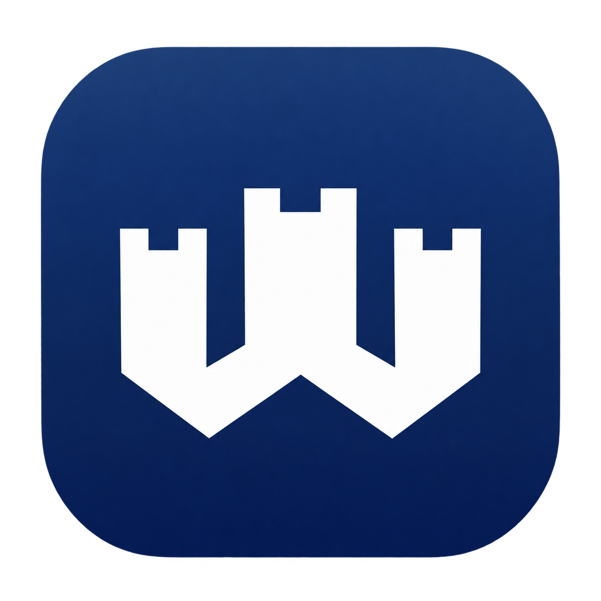

<p align="center">
  
</p>

<h1 align="center">Wardtone · 戍声</h1>

<p align="center">卫戍协议的声音工作台</p>

<p align="center">
  <a href="https://github.com/DrSmoothl/Wardtone/actions/workflows/build.yml"></a>
</p>

戍声是一款 Windows / macOS 桌面工具，用于管理《明日方舟》卫戍协议的终端播报、公共音效与背景音乐。你可以试听资源、制作自己的声音方案、导入他人的分享包，并在同一个界面中完成替换与恢复。应用内置运行时，使用时无需安装 Node.js 或其他开发工具。

[下载构建](https://github.com/DrSmoothl/Wardtone/actions/workflows/build.yml) · [音频用途](docs/playback-reference.md) · [兼容状态](docs/verification.md) · [反馈问题](https://github.com/DrSmoothl/Wardtone/issues)

## 功能

- **定位资源**：自动寻找本机安装，也可手动选择目录；内置 ADB 连接模拟器，支持官服、B 服和自定义端口。
- **浏览与试听**：按终端播报、公共音效和背景音乐筛选，搜索用途与编号，查看时长、播放条件、随机候选和叠加规则。
- **制作声音方案**：导入自定义音频，调整裁剪、音量与采样率；支持引用原音、静音和批量匹配。背景音乐默认保留最多双声道，并可循环试听。
- **分享语音包**：制作、导入、导出 `.ssvoice` 文件，保存名称、版本、作者、描述与逐条替换内容。
- **选择替换方式**：支持保持官方文件大小或使用变长资源，以及关闭游戏后替换或启动后替换。
- **备份与恢复**：写入前保留原始备份，校验文件摘要并记录事务。重复应用同一方案保持幂等，检测到外部修改时停止并提示。
- **日志与诊断**：在界面中查看操作记录、失败原因，导出诊断信息用于排查。

## 下载与运行

打开 [Actions 构建页面](https://github.com/DrSmoothl/Wardtone/actions/workflows/build.yml)，选择最新一次成功运行，在页面下方的 **Artifacts** 下载对应平台。下载 Actions 附件需要登录 GitHub。产物保留 14 天。

| 附件                   | 适用设备          | 内容                        |
| ---------------------- | ----------------- | --------------------------- |
| `Wardtone-windows-x64` | Windows x64       | NSIS 安装程序、完整应用 ZIP |
| `Wardtone-macos-arm64` | Apple Silicon Mac | 应用 ZIP                    |
| `Wardtone-macos-x64`   | Intel Mac         | 应用 ZIP                    |

Windows 可运行安装程序，也可完整展开 ZIP 后启动其中的应用。Mac 展开 ZIP，将「戍声.app」放入「应用程序」后启动。当前构建未签名，首次打开可能需要按系统提示确认来源。

Windows 的路径发现覆盖安装注册表、Program Files、用户资源目录及各盘符的常见游戏目录。非标准安装位置可手动选择。模拟器需要先启动并开启 ADB 调试；首次连接时，在模拟器内允许本机调试请求。

macOS Apple Silicon 已完成本机游戏资源发现检查。Windows 真游戏、Windows 模拟器和 Intel Mac 的实机状态见 [兼容状态](docs/verification.md)；每次构建的自动检查结果可在 Actions 中查看。

## 开始使用

1. 在游戏中下载需要的活动资源和语音语言包，完成更新。
2. 首次打开戍声，选择本机客户端或模拟器，连接资源目录并扫描。
3. 进入「语音库」，试听目标音频，查看右侧信息按钮中的播放条件。
4. 添加到制作草稿，选择自定义音频、原音引用或静音；填写包名、作者与版本并保存。
5. 回到「工作台」，生成替换计划，检查文件大小与备份信息后应用。
6. 需要撤销时，在「备份与恢复」选择对应记录进行恢复。

已有 `.ssvoice` 分享包可以直接导入；你制作的语音与音乐也可以放在同一个包中导出。

### 大小与热替换

保持官方大小模式要求生成的资源包能装入原文件空间。音频时长、采样率、声道和编码都会影响结果，并非统一的秒数限制。装不下时，界面会报告原因；可缩短音频、使用紧凑单声道编码，或选择变长资源。

变长模式首次启用需要关闭游戏。热替换的生效时机取决于游戏何时重新读取资源，已经载入的声音可能继续使用缓存。游戏更新或资源修复后，先重新扫描再应用方案。

### 背景音乐

「语音库 → 背景音乐」收录活动主界面、整备、领袖作战与隐秘领袖四首音乐。导入默认使用 44.1 kHz、16 位 PCM，保留最多双声道；也可选择紧凑单声道。选取适合首尾衔接的片段，开启循环试听检查接缝。

### 外观

「设置 → 外观」提供四套完整主题，切换后即时保存：

| 主题                     | 风格                                   |
| ------------------------ | -------------------------------------- |
| “全能的”可露希尔（默认） | 蓝紫多窗口桌面、玫红按键与终端拼贴     |
| 卫戍协议终端             | 青绿战术面板、网格与切角框架           |
| 乌萨斯齐心团             | 深青机架、浅色金属面板与工业仪表       |
| 经典                     | 紧凑布局，五种强调色，跟随系统深浅外观 |

字体与主题图片随应用内置。界面支持缩放与减少动态效果。

## 开发与构建

业务代码、Electron 桌面进程、资源处理与 ADB 适配使用 TypeScript，前端使用 React。开发环境使用 Node.js 26 LTS，版本记录在 `.node-version`。

```sh
npm ci
npm run dev
```

| 命令                        | 用途                             |
| --------------------------- | -------------------------------- |
| `npm run typecheck`         | TypeScript 类型检查              |
| `npm test`                  | 不依赖游戏素材的通用测试         |
| `npm run build`             | 构建前端、桌面进程与后台任务     |
| `npm run package:win`       | Windows x64 安装程序和 ZIP       |
| `npm run package:mac`       | macOS arm64 ZIP                  |
| `npm run package:mac:intel` | macOS x64 ZIP                    |
| `npm run test:fixtures`     | 本机资源副本的事务与用途目录测试 |
| `npm run test:integration`  | 本机副本的音频格式与重封装检查   |

打包命令在对应系统运行，产物位于 `release/`。本机素材测试从 `.fixtures/Bundles` 或 `WARDTONE_FIXTURE` 指定位置读取资源副本，缺少文件时直接报错。开发时可用 `WARDTONE_DATA` 指定独立应用数据目录。

GitHub Actions 在 push、PR 和手动触发时自动完成类型检查、测试与三种平台架构的打包，并保存安装包和诊断附件。Runner、依赖缓存及日志位置见 [构建说明](docs/ci.md)。

- [界面规范](docs/design.md)
- [主题扩展](docs/themes.md)
- [音频用途目录](docs/playback-reference.md)
- [协作约定](AGENTS.md)

反馈问题时请附应用版本、系统、客户端或模拟器类型，以及失败的操作步骤。诊断文件可能包含本机路径，公开分享前请查看内容。

## 免责声明

Wardtone 是玩家制作的第三方工具，与鹰角网络及《明日方舟》的运营方不存在隶属、合作或官方背书关系。

本工具会修改本地游戏资源。使用前请了解并遵守适用的游戏服务条款，保留备份并自行决定是否使用。资源更新、版本差异或替换内容可能造成声音异常、资源被覆盖或加载失败；使用产生的风险与后果由使用者承担。项目按现状提供，不作适用性或持续兼容性的保证。

《明日方舟》的名称、角色、美术、语音、音乐及相关商标归各自权利人所有。仓库不提供官方语音或音乐文件；主题图片的来源与权利说明见 [第三方素材](THIRD_PARTY_NOTICES.md)。制作或分享声音方案时，请确保自己拥有相关音频的使用与传播权限。

## 许可与致谢

项目代码采用 [MIT License](LICENSE)。第三方字体、音频格式数据与游戏美术分别适用其原有许可或权利声明，不因本项目的代码许可而重新授权。完整说明见 [THIRD_PARTY_NOTICES.md](THIRD_PARTY_NOTICES.md)。

感谢 Electron、React、Radix UI、Yume-chan ADB 及所用开源字体与音频格式数据的维护者。
